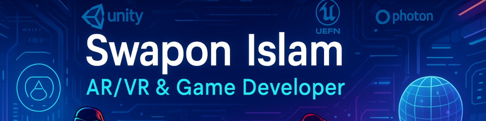

<!-- Banner & Header -->

  

    

  

   

  
  
  

---

### 🧑‍💻 About Me

- 🥽 **Spatial Computing & XR Developer** building wearable AR, VR, and interactive installations in **Unity** & **Unreal Engine 5**
- 🧍 **Motion-Tracking Engineer** specializing in **Microsoft Kinect / Azure Kinect** skeletal tracking & real-time sensor pipelines
- 🚀 **AI + XR Fusion** integrating computer vision and real-time networking into immersive 3D environments
- 🌍 Focused on turning complex hardware-software ideas into responsive, production-ready experiences

---

### 🚀 Featured Projects

<table>
  <tr>
    <td width="50%" valign="top">
      <strong>🎴 Teen Patti Multiplayer</strong> 
      Real-time 6-player card game with synchronized game state, room matchmaking, and low-latency networking.  
      <code>Unity3D</code> <code>C#</code> <code>Photon PUN 2</code>
    </td>
    <td width="50%" valign="top">
      <strong>🧍 Kinect Motion Game</strong> 
      Full-body motion-controlled <em>“Red Light, Green Light”</em> interactive experience powered by depth-sensor skeletal tracking.  
      <code>Kinect SDK</code> <code>Unity</code> <code>C#</code>
    </td>
  </tr>
  <tr>
    <td width="50%" valign="top">
      <strong>👕 AI AR Fitting Room</strong> 
      Mobile augmented reality virtual try-on application combining body segmentation and computer vision.  
      <code>ARCore</code> <code>ARKit</code> <code>Python</code> <code>CV</code>
    </td>
    <td width="50%" valign="top">
      <strong>🕶 VR/AR Booth Showcase</strong> 
      Interactive spatial exhibition booth blending mixed-reality environments with AI-driven user interaction.  
      <code>Unreal Engine 5</code> <code>OpenXR</code> <code>MRTK</code>
    </td>
  </tr>
</table>

---

### 🛠 Skills & Tech Stack

| Category | Technologies |
| :--- | :--- |
| **💻 Languages** | C#, C++, Python, Verse |
| **🎮 Game Engines** | Unity3D, Unreal Engine 5, UEFN |
| **🥽 XR Frameworks** | XREAL SDK, ARFoundation, MRTK, Oculus SDK, ARKit, ARCore |
| **🌐 Networking** | Photon PUN 2, Mirror, Unity Netcode |
| **🧍 Hardware & SDKs** | Kinect / Azure Kinect, Vuforia, Wikitude, Immersal |
| **📱 Platforms** | Windows, Android, iOS, XREAL, Oculus / Meta Quest, HTC Vive, HoloLens |

---

### 📊 GitHub Highlights

  <table>
    <tr>
      <td align="center">
        
      </td>
      <td align="center">
        
      </td>
    </tr>
  </table>

